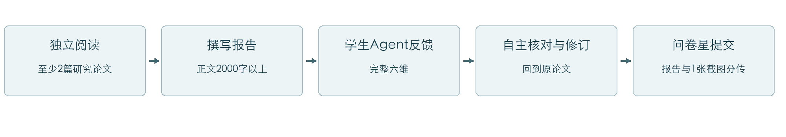
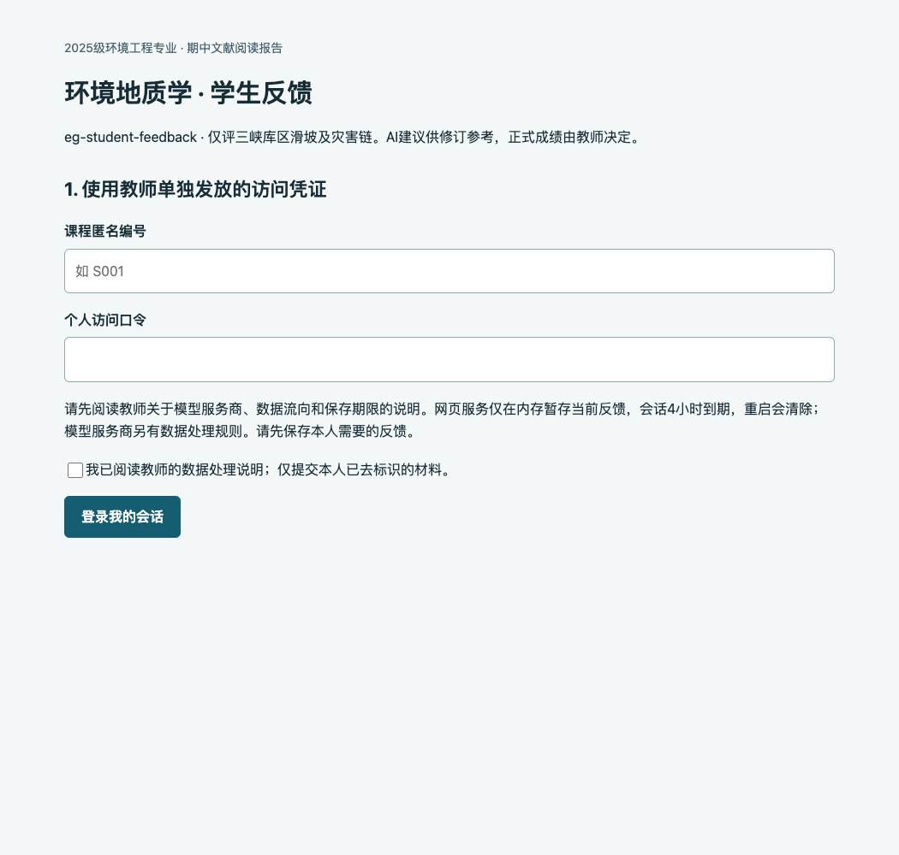
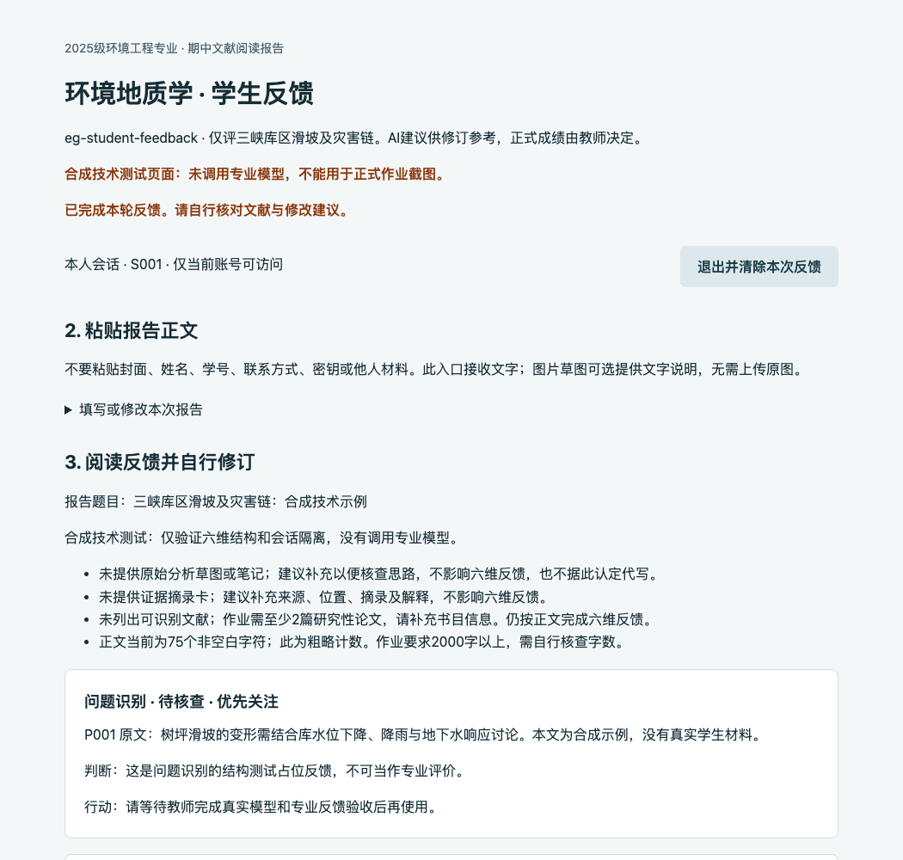

# 《环境地质学》期中文献阅读报告
2025级环境工程专业 · 学生操作指南

本次作业先独立阅读和写作，再使用课程学生端Agent检查报告，最后自行修订。正式提交的材料只有文献阅读报告和1张真实运行截图，分别上传问卷星。

## 1. 作业要求

| 项目 | 要求 |
| --- | --- |
| 选题范围 | 仅限三峡库区滑坡及灾害链相关地质问题，自拟题目 |
| 正文字数 | 2000字以上；封面、参考文献不计入正文 |
| 阅读文献 | 至少2篇研究性论文，建议中文、英文各1篇 |
| 封面 | 自行设计，完整包含报告题目、课程名称、专业班级、姓名、学号、提交日期 |
| AI使用 | 使用教师发布的 eg-student-feedback 入口获得反馈，自主核对和修改 |
| 正式提交 | 通过问卷星分别上传最终报告和1张Agent运行截图 |
| 过程材料 | 原始分析草图、证据摘录卡、修订说明和完整聊天记录均非必须；已有草图、证据卡可选用于辅助反馈 |

研究性论文通常应有明确研究问题、数据或实验/监测/模拟方法，以及具体研究结果。综述、新闻、百科和工程宣传材料可辅助了解背景，不能替代至少2篇研究性论文。英文论文为建议，不是额外的拒绝反馈条件。

可以研究库水位变化与滑坡变形、降雨和地下水作用、监测证据、滑坡入水与涌浪传播情景，以及与机制匹配的防治措施。单纯介绍三峡工程概况、一般水污染或与滑坡灾害链无关的地质问题不符合范围。灾害链中的假设情景须与已发生事件分开写。

<!-- pagebreak -->

## 2. 先认清入口和工具

课程专用网页入口：〔教师填写；当前尚未启用〕

问卷星提交地址：〔教师填写〕　截止日期：〔教师填写〕

课程支持联系渠道：〔教师填写〕

模型服务商、数据流向与保留政策：〔教师填写并告知后，方可提交真实报告正文〕

GitHub仓库：https://github.com/zytju/openclaw-environmental-geology-feedback

| 名称 | 是什么 | 本次作业如何使用 |
| --- | --- | --- |
| OpenClaw | 可部署的Agent运行框架，可连接模型、工具和Skills | 教师原有项目的运行基础；学生默认不必安装 |
| WorkBuddy | 腾讯的AI工作台，可规划任务、处理文件并扩展技能 | 可选拓展工具；不是课程入口，也不会自动获得课程权限 |
| Agent / Skill | Agent承担固定角色；Skill提供该任务的规则与参考 | 学生角色是 eg-student-feedback，六维规则由课程提供 |
| GitHub | 源码、说明和版本的公开仓库 | 阅读教师提供的说明和教程，不在这里提交作业 |

本次新增网页版本加载学生Agent与两个学生Skill的规则，通过独立的无工具文本模型接口生成反馈。它不向学生开放OpenClaw管理界面。网页版本的课程规则与旧项目相衔接，实际访问方式以教师最终通知为准。

GitHub下载不等于Agent已经运行。GitHub Pages只提供静态网站托管，不能独立承担本项目的模型密钥保管、账号鉴权和私人会话服务。不要把仓库地址当成学生反馈网址，也不要把报告上传到Issue、PR、公开仓库或公开聊天链接。

当前没有正式课程URL。请等待教师完成服务与权限验收并填写以上信息。下文截图来自本机合成测试，只用于说明操作，不能作为本次作业的运行证明。

<!-- pagebreak -->

## 3. 从GitHub阅读课程资料

打开仓库首页后，先阅读README最上方的“期中文献报告学生入口”。该段会指向本指南和教师部署状态，避免误用历史作业要求。

建议阅读顺序：README → 本学生指南 → 两个学生Skill的说明 → 必要时查看历史资料。学生不必运行命令，也不必下载整个项目。

| 仓库位置 | 你需要了解的内容 |
| --- | --- |
| docs/student-guide_20261109_1300.md | 本次期中作业和网页操作，以本指南为准 |
| agents/eg-student-feedback/AGENTS.md | 学生角色的工作范围和权限边界 |
| skills/eg-authenticity-anchor/SKILL.md | 草图、证据卡的检查与可选规则 |
| skills/eg-report-feedback/SKILL.md | 六维专业反馈原则 |
| case-study/rubric.json | 六个专业评价维度，可了解标准，无需编辑 |
| history/、旧日期文档和旧发行版 | 历史案例与流程，不能替代本次任务书 |

在GitHub中点击目录名和文件名即可阅读，浏览公开文件通常不需要登录。若教师指定了课程分支或版本，先在左上方分支选择器切换到教师指定版本；不要自行挑选旧发行版。只有教师通知PR已合并或明确指定新分支后，才按该版本操作。

如确需下载，点击绿色“Code” → “Download ZIP”，解压到本人新建的学习文件夹。下载包含源代码和历史资料，不代表其中的旧配置适合直接安装。不要把真实报告、封面、密钥或访问口令保存进准备公开上传的项目目录。

公开仓库中的教师端代码可以阅读，但阅读代码不等于获得教师服务、正式评分或其他学生材料的访问权。不要运行教师Agent冒充正式评价。下载到自己电脑上的程序，也不会自动成为教师验收过的课程入口。

<!-- pagebreak -->

## 4. 登录本人的学生会话

1. 等教师发布正式链接和个人访问凭证。链接应与课程通知一致，正式入口使用HTTPS。
2. 打开链接，填写教师单独发给本人的课程匿名编号和个人口令。课程匿名编号不等同于学号。
3. 阅读教师关于模型服务商、材料流向和保留政策的说明，同意后登录。
4. 登录后确认显示“本人会话”。不要共享口令、借用账号或尝试访问他人的会话地址。

图1　本机登录页面实测截图，口令栏为空。正式服务未开放；此图不是可提交的作业截图。图中输入的是课程访问口令，不是模型API Key。

<!-- pagebreak -->

## 5. 提交正文，获得完整六维反馈

在“填写或修改本次报告”中填写题目，粘贴正文和参考文献书目信息。本次关注点可粘贴第7节提示词。不要粘贴含姓名、学号的封面；保留正文中必要的作者、年份和文献引用。

已有原始分析草图时，可在可选区填写草图的文字说明；已有证据卡时，可填写来源、页码/图表或段落位置、摘录及自己的解释。本版网页接收文字，不要求上传图片或原论文全文。两个可选区都留空，也应得到完整六维反馈。

点击“获取完整六维反馈”，保持页面打开。若显示繁忙或处理中，请稍后再试，不要连续重复点击。报告会在反馈后收起，点击“填写或修改本次报告”可重新展开。

图2　本机合成输出，用于演示反馈位置与材料提醒，不含真实模型专业判断。正式作业须使用本人报告获得真实反馈，不能提交此图或其他同学截图。

<!-- pagebreak -->

## 6. 怎样读懂六维反馈

| 维度 | 重点检查什么 |
| --- | --- |
| 问题识别 | 地质问题、具体滑坡、研究范围和受影响对象是否明确 |
| 证据提取 | 关键结论能否追到论文位置；区分观测、模拟与推断，核查单位和时段 |
| 推理链完整性 | 地质条件、水文响应、力学作用与结论之间是否有中间环节；是否将相关性直接写成因果 |
| 灾害链分析 | 触发、传播和受体是否对应；每一环节的证据与假设是否清楚 |
| 不确定性表达 | 哪些是事实、推断或假设；资料限制怎样影响结论 |
| 防治建议匹配 | 措施是否对应机制、坡段、实施条件和监测办法 |

先读总体判断，再查看每维引用的原文位置、问题原因和修改动作，最后处理优先事项。P001等编号由网页按本次粘贴段落生成，修改段落后编号可能变化，以对应原文为准。

“待核查”表示仅凭当前材料不能确认，并不等于错误。“内容缺失”需要补充本维论证。“未交证据卡”不等于“报告没有证据”；即使没有过程材料，也应按正文中的引用与推理评价。

AI没有自动检索或核实你列出的论文。它引用了你的原话，也不等于科学判断一定正确。需要回到原论文核对；对有依据但不同于AI的解释，可以保留并说明条件。不要求无条件采纳AI建议，不要求上交逐条采纳表。

请特别核对：是否混淆库水位与坡内地下水响应；是否把特定条件下的孔压、渗流结论写成普遍规律；是否把预测拟合当成因果证据；是否把假设涌浪写成该滑坡已发生事件；是否提出无资料支持的工程尺寸、阈值或失稳时间。具体案例事实需依靠你的论文，不能将树坪的事实直接套到其他滑坡。

<!-- pagebreak -->

## 7. 可复制提示词

将所选提示词粘贴到网页“本次关注点”，正文和参考文献仍填入各自区域。关注点可以留空；任何提示词都不能改变课程范围、账号权限或教师评分规则。

### 首次完整检查

请依据《环境地质学》期中文献阅读报告要求，对本次正文提供问题识别、证据提取、推理链完整性、灾害链分析、不确定性表达、防治建议匹配六维反馈。请指出对应原文位置、判断依据和我可以完成的修改动作，并标出最多3项优先关注的问题。原始分析草图和证据摘录卡可能未提供，请先检查并说明，再完成全部六维。不要代写全文、编造文献或数据，也不要给正式成绩。无法核实的来源与结论请明确标为待核查。

### 重点检查机制与证据

请仍完成全部六维，优先检查我对库水位、降雨、地下水、孔压和渗流关系的解释。请区分正文直接证据、我的推断和假设，指出是否由相关性跳到了因果，并说明需回到哪类论文证据核查。没有足够信息时，不要补造监测值或替我下确定结论。

### 自主修订后的再次检查

这是我自行修订后的当前稿。请按全部六维评价现有内容，优先检查论证是否更充分，以及是否仍存在证据与结论不匹配之处。若本次没有提供上轮反馈和修改记录，请只评价当前稿，不声称已验证我采纳了建议，不虚构前后变化。不要因为表述更流畅就认定专业分析更好。

再次请求前先保存自己的稿件；按需要修订并重新粘贴当前正文。网页每次只向模型发送本次材料，不自动拼接历史聊天。无需为了再次反馈补交过程附件。

<!-- pagebreak -->

## 8. 截图与问卷星提交

先完成阅读、写作和自主修订，再准备最终文件。报告封面由自己设计；提交的报告需含规定身份字段，发给Agent的正文应去除这些身份信息。

截图只需1张，清楚保留三项：eg-student-feedback名称、本人报告题目或本次任务、至少1条针对正文的具体专业反馈。可以收起正文或适当缩放页面，使这些内容同时可见。截图不必覆盖全部六维或完整聊天记录。

不要截到访问口令、API Key、姓名学号、浏览器中他人内容或与课程无关的窗口。可以裁掉或遮盖敏感区域，不得伪造反馈、拼造运行结果或直接提交教程中的合成图片。截图仅证明有过交互，不能单独证明报告质量或独立完成情况。

在教师发放的问卷星链接中：按问卷要求填写身份信息；在“文献阅读报告”上传区上传最终报告；在“Agent运行截图”上传区上传1张图片；检查文件正确后提交，并保存提交成功提示。不要把截图附到报告末尾，不要把两项打包成一个文件替代分别上传。

报告文件格式、大小限制和截止时间以问卷及教师通知为准。文件命名可用“班级_姓名_学号_文献阅读报告_YYYYMMDD_HHMM”和“班级_姓名_学号_Agent截图_YYYYMMDD_HHMM”，其中时间填写实际保存时间；这些文件只通过指定私有提交入口传递。

### 提交前核对

- 选题属于三峡库区滑坡及灾害链，正文2000字以上。
- 至少阅读并引用2篇研究性论文，引用内容能回到原文核对。
- 自拟题目；封面含题目、课程名称、专业班级、姓名、学号、日期。
- 已自行判断AI建议，未将AI生成的虚构数据或文献写入报告。
- 问卷星分别上传最终报告和1张截图；截图不附报告末尾。
- 没有因缺草图、证据卡或修订说明而被要求补交才能获得反馈。

<!-- pagebreak -->

## 9. 可选拓展：本地安装OpenClaw与接入API

完成课程网页任务不要求本地安装、购买API或注册WorkBuddy。以下仅供个人探索，不替代教师发布的课程入口或真实作业截图。不要在共用电脑上使用个人模型密钥。

1. 先阅读OpenClaw官方入门与安全说明。确认操作系统和Node.js满足当前官方要求，并了解Agent可能获得文件或命令能力。
2. 在本人设备的新建学习目录试用。当前官方提供“npx openclaw@latest”启动方式，也提供macOS/Linux与Windows安装指南。只从官方获取，不直接执行陌生教程的安装命令。安装会写入个人配置，先检查是否已有需要保留的OpenClaw环境。
3. 首次向导中选择模型服务商；若使用API，填自己的密钥和正确模型标识。不要复制教师Gateway令牌或教师模型密钥。需要自行设定费用预算。
4. 按向导完成后，用“openclaw gateway status”检查状态，用“openclaw dashboard”打开本人管理界面，先用不含身份信息的测试句验证连接。
5. 需要尝试课程规则时，先阅读仓库学生Agent和两个学生Skill，再由教师提供与该版本匹配的安装说明。不要整份套用同时包含教师Agent的旧配置，不要开启不必要的工具或把个人Gateway暴露给同学。

| 接入项 | 应从哪里获得 | 常见错误 |
| --- | --- | --- |
| API Key | 自己获授权的模型服务商控制台 | 把聊天软件账号密码、课程口令当密钥 |
| 模型标识 | 服务商实际开放的模型列表 | 把产品宣传名称直接当API模型名 |
| API地址与协议 | 服务商官方文档 | 复制陌生中转地址，或接口协议不匹配 |
| 用量与预算 | 服务商用量、限额设置 | 以为本地运行就不会产生模型费用 |

接入失败先检查密钥权限、余额/配额、模型标识、API地址和网络，再联系服务商；只发已去除凭证的报错。不要上传配置文件、截取完整密钥或让他人远程查看凭证。

课程既有OpenClaw实测版本为2026.7.1-2；当前官方入门流程可能已更新。最新版个人安装不等于本课程旧配置已兼容。本指南没有替你安装软件，也未验证每种操作系统及模型服务商。

<!-- pagebreak -->

## 10. 可选拓展：WorkBuddy与密钥保护

WorkBuddy可用于了解AI如何拆解任务、处理文件和使用技能。它与OpenClaw不是同一个软件；安装WorkBuddy不会自动连接教师Agent，也不会继承课程的会话隔离与权限配置。

个人体验步骤：从WorkBuddy官方网站下载适配自己系统的安装包；按提示安装并使用本人账号登录；新建任务；先用虚构的短材料请求解释一个地质概念；核对输出。不要一开始就授权访问整台电脑或包含同学材料的目录。

按当前官方文档，自定义模型可通过可视化模型配置页面填写API Key、模型标识、API地址及相应协议，保存后测试连接。可先使用产品已提供的模型，不必为课程作业额外购买；是否收费、支持哪些模型及具体菜单名称，以个人账号和当前官方文档为准。密钥保存在本地，并不意味着请求内容不经过模型服务商。

### 保护材料和凭证

- 只用自己有权使用的密钥，设置限额，结束探索后按需要撤销。密钥泄露后应立即撤销并检查用量，不能只删掉截图。
- 不把密钥放入GitHub、提示词、聊天记录、问卷星报告、截图或公共网盘。不要把教师口令转发给同学。
- 本地Agent可能有文件操作与命令能力。本课程网页反馈无需这些权限；个人安装也只授予必要范围，不加载来历不明的插件。
- 给Agent的正文去除封面身份信息；论文作者与公开书目信息可以保留。不要上传他人报告。
- 课程网页中的反馈在本服务内存暂存，会话4小时到期，服务重启会清除；“清除反馈”或退出会删除网页服务中的本次记录，不能代替模型服务商侧的数据删除。

### 官方参考与常见问题

入口未开放：等待教师通知，不把GitHub下载或合成演示当真实运行。口令失效：联系教师核验本人编号，不借用账号。提示繁忙：稍后重试。模型错误或结果未通过校验：保留已去标识的错误提示并联系教师，不连续重复提交。收到要求草图、证据卡齐全才评六维的回复：反馈给教师修正规则，不必因此补交过程材料。

以下官方页面于2026年11月9日查阅，安装和界面变化以官方最新版为准：

- [OpenClaw入门](https://docs.openclaw.ai/start/getting-started)
- [OpenClaw安全边界](https://docs.openclaw.ai/gateway/security)
- [WorkBuddy简介](https://www.codebuddy.cn/docs/workbuddy/Overview)
- [WorkBuddy安装与首个任务](https://www.codebuddy.cn/docs/workbuddy/FirstTask)
- [WorkBuddy模型配置](https://www.codebuddy.cn/docs/workbuddy/From-Beginner-to-Expert-Guide/Function-Description/Model)
- [GitHub Pages说明](https://docs.github.com/en/pages/getting-started-with-github-pages/what-is-github-pages)
