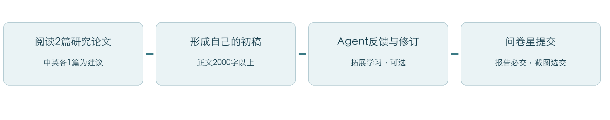
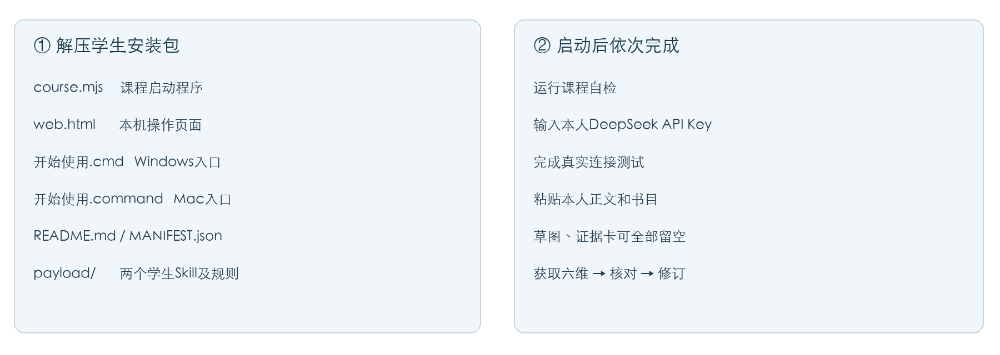
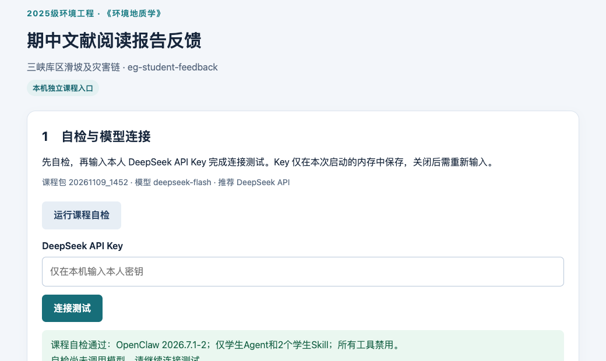
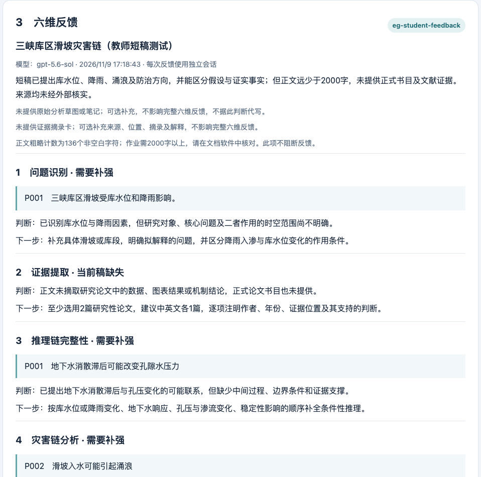

# 《环境地质学》学生安装与使用图文指南
2025级环境工程专业 · 期中文献阅读报告 · 说明更新2026年11月9日

## 先完成主作业，再按需体验Agent

主作业：仅限三峡库区滑坡及灾害链相关地质问题；至少阅读2篇研究性论文，建议中文、英文各1篇；正文2000字以上。综述、新闻、百科等可作背景资料，不能替代要求阅读的2篇研究性论文。

封面自行设计，完整包含报告题目、课程名称、专业班级、姓名、学号、提交日期。正文、封面、参考文献分清楚，封面及参考文献不计入正文字数。字体、字号、行距等按清晰、统一原则排版，未规定的项目不作为新增硬性要求。

报告于11月27日12:00前仅通过教师指定问卷星提交。OpenClaw、API和Agent属于拓展学习，不计入平时成绩；截图选交。如选交，单独上传1张本人真实运行截图，不附在报告末尾。草图、阅读笔记、证据摘录卡、完整聊天记录均非必交。

图1　独立阅读、形成自己的分析，再用反馈修订。安装和API连接成功并不等于已经完成作业。

### 这份指南能带你完成什么

了解工具关系 → 下载课程包 → 安装指定OpenClaw → 创建本人DeepSeek API Key → 运行自检和连接测试 → 粘贴初稿 → 阅读六维反馈 → 核对修订 → 问卷星提交。

<!-- pagebreak -->

## 1　OpenClaw、WorkBuddy、模型与课程包

| 名称 | 在本作业中的作用 |
| --- | --- |
| OpenClaw | 在自己电脑上运行Agent的程序。它需要可用的模型接入；安装程序不代表已经接通模型。 |
| DeepSeek API | 给OpenClaw提供模型能力的推荐接入。使用本人账号及API Key，按平台规则计费；网页聊天账号不等于已经有可用API余额。 |
| WorkBuddy | 腾讯的桌面Agent产品，支持多模型和本地工具。与OpenClaw是不同产品，本课程包只按OpenClaw验证。 |
| eg-student-feedback | 课程学生反馈角色，只评三峡库区滑坡及灾害链文献报告。 |
| 两个学生Skill | eg-authenticity-anchor检查材料与证据边界；eg-report-feedback给出完整六维专业反馈。 |

本指南推荐“OpenClaw＋本人DeepSeek API＋教师指定课程包”。WorkBuddy可用于认识不同Agent产品，不要求另装，也不能把相同名称的Skill可导入理解为权限与课程效果已经一致。

课程包默认关闭全部模型工具，不提供命令、系统文件读写、配置修改、联网检索、其他会话读取或教师端评价。课程启动程序会处理本课程固定文件及本人粘贴的正文；这与向模型开放文件工具是两回事。

### 本地入口与教师网页

本包启动后自动给出以127.0.0.1开头的本人电脑地址，端口每次可变；按启动窗口显示的完整地址打开。不要把该地址发给同学当公共课程入口。

教师统一网页入口：**［待教师填写；当前采用本地课程包］**。GitHub仓库用于下载和阅读代码，不能直接当作已运行的课程Agent网站。每人本机独立安装、每次反馈新建会话；共享电脑仍需各自的系统账号及本人模型账号。

官方资料：[OpenClaw安装说明](https://docs.openclaw.ai/install)、[WorkBuddy官方介绍](https://cloud.tencent.com/product/workbuddy)、[DeepSeek首次API调用](https://api-docs.deepseek.com/)。

<!-- pagebreak -->

## 2　从GitHub下载，按这条路径阅读

仓库：[zytju/openclaw-environmental-geology-feedback](https://github.com/zytju/openclaw-environmental-geology-feedback)。

1. 已收到教师发放的“环境地质学_学生安装包_20261109_1710.zip”，可继续使用，无需重装。它只含学生课程必需文件，不含教师角色或任何密钥。
2. 如从仓库下载，打开默认首页，保持main分支，点击页首“下载学生安装包”。不需要切换分支或单独下载student-native文件夹。
3. 也可打开[课程学生安装包页面](https://github.com/zytju/openclaw-environmental-geology-feedback/blob/main/downloads/eg-student-kit_20261109_1710.zip)，点击 Download raw file 下载。完整仓库“Code → Download ZIP”会包含教师历史代码；不要运行教师端脚本，不要把整个仓库直接注册成学生Agent。
4. 右键解压ZIP，打开解压后的文件夹，应看到 course.mjs、web.html、“开始使用.cmd”、“开始使用.command”、README.md，以及payload文件夹。不要只下载一个SKILL.md，不要在压缩包预览窗口直接运行。

图2　文件结构示意。课程启动器会自行创建独立配置，不要求手工把文件复制到个人OpenClaw默认配置目录。

### 只需要读这些内容

先读仓库README及student-native/README.md了解用途；再读本指南完成操作。想了解规则时，依次看学生Agent说明、eg-authenticity-anchor、eg-report-feedback及期中模式说明。eg-teacher-review、eg-rubric-check与历史运行文件属于教师侧，不需要安装或运行。

不需要Fork仓库、注册GitHub账号或上传报告。不要在GitHub Issue中粘贴报告、封面、密钥或运行目录。

<!-- pagebreak -->

## 3　安装OpenClaw：先确认版本，再装课程包

本课程实测OpenClaw为 **2026.7.1-2**，Node应使用其支持的版本，例如24.15.0及以上的24系列。以下指定版本已核对可在官方npm软件源下载。系统安装可能需要网络；已安装的同学先检查版本，不必反复重装。

### Windows

打开开始菜单，搜索PowerShell并打开。若没有Node和npm，复制下面一行到PowerShell执行；这是OpenClaw官方安装器，指定课程版本并跳过个人Agent初始配置：

    & ([scriptblock]::Create((iwr -useb https://openclaw.ai/install.ps1))) -Tag 2026.7.1-2 -NoOnboard

按安装器提示完成，关闭后重新打开PowerShell。若已有可用Node和npm，可直接运行下面的指定版本安装命令。

安装指定版本：

    npm install -g openclaw@2026.7.1-2

检查：

    node --version
    openclaw --version

若PowerShell提示npm.ps1不能运行，可改用npm.cmd执行同一安装命令，不要为了本作业关闭系统安全保护。安装完成后关闭并重开终端。

### macOS

若已有可用Node和npm，同样运行上面的安装命令。若尚未安装，可使用OpenClaw官方安装器的指定版本和跳过初始配置参数：

    curl -fsSL https://openclaw.ai/install.sh | bash -s -- --version 2026.7.1-2 --no-onboard

随后重开终端，检查node --version和openclaw --version。不要运行来源不明的“免配置”“共享API Key”安装包，不用为本课程启用聊天平台、系统控制或额外插件。

### 成功标志

版本输出含2026.7.1-2。若当前版本不同，课程自检会停止；请向教师反馈版本，不要把“能够聊天”当作已兼容。Windows脚本虽提供，具体电脑仍须通过后面的自检、真实连接及六维反馈。

<!-- pagebreak -->

## 4　启动课程包，先运行自检

Windows：在解压目录双击“开始使用.cmd”。macOS：打开终端，输入bash和一个空格，再把“开始使用.command”拖到终端，按回车。这样无需为下载文件修改可执行权限。

两种系统也可在课程包所在目录执行：

    node course.mjs start

首次启动在本人Documents/文稿目录创建EG-Midterm-2026-20261109_1452，安装学生Agent和两个Skill，不修改已有个人OpenClaw配置。已有未知目录不会被覆盖；报错时保留旧目录求助，不直接删除或覆盖。

启动窗口会显示本次本机地址，浏览器通常自动打开。若没打开，复制窗口中的完整地址到浏览器。启动窗口要保持打开，关闭即停止服务。

图3　本机课程页面。先点击“运行课程自检”；成功应提示OpenClaw版本、学生Agent、两个Skill和全部工具禁用。自检不调用真实模型，不证明API Key有效。

若网页提示从本次地址重新打开，请回启动窗口重新复制完整地址；不要手工删除末尾的访问标记或照抄图中的端口。

<!-- pagebreak -->

## 5　推荐接入本人DeepSeek API

1. 打开[DeepSeek开放平台](https://platform.deepseek.com/)，使用本人账号登录，了解当前计费规则，检查API可用余额。是否充值及额度由本人决定，AI拓展不计入平时成绩。
2. 在平台API Keys页面创建本次学习使用的Key，妥善保存。网页聊天能够使用，不代表API Key和余额已经就绪。
3. 回到本机课程页面，把Key粘贴到密码输入框。不要把Key发给教师、同学或聊天助手，不要放进提示词、报告、截图或GitHub。
4. 点击“连接测试”。等待出现“课程连接测试成功”和模型名称，再继续。测试会产生少量模型用量。

| 接入项目 | 课程包默认值 |
| --- | --- |
| 服务商 | DeepSeek官方API |
| 接口地址 | https://api.deepseek.com |
| 模型 | deepseek-flash |
| API Key | 本人创建，只在本机页面输入 |
| 工具权限 | 全部禁用，不需为接通模型开放shell、文件或教师权限 |

以上参数按2026年11月9日官方资料核对，课程包已填好，不用手改JSON。模型名称可能调整；若报模型不存在，先查[官方接入文档](https://api-docs.deepseek.com/)，向教师反馈，不要盲目换为陌生中转接口。

### 密钥与报告保存

关闭启动窗口后需重新输入Key。启动包不把Key写入课程配置，连接成功后清空页面输入框；仍应保护本机课程目录和系统账号。Key泄露后到平台撤销并重建，避免他人消耗余额。

仅将题目、正文和书目发给模型。真实姓名、学号、联系方式留在最终报告封面中；草图和证据卡若提供，也应检查其中的身份信息。本地OpenClaw会保留会话，模型服务商也按其政策处理输入。不要上传他人材料或无权外传的全文。

<!-- pagebreak -->

## 6　粘贴初稿，获得完整六维

先独立读论文并写出初稿。课程反馈Agent不能联网找论文，也不负责替你写完整报告。检索、提纲及文档格式辅助提示词在后面，可用于另开的合适工具会话。

在课程页面填写题目、正文、两篇研究性论文的书目；保留正文段落换行。封面不要复制进来。“希望优先检查的问题”可粘贴下面内容：

    请按《环境地质学》期中文献阅读报告要求，检查三峡库区滑坡及灾害链的完整六维：问题识别、证据提取、推理链完整性、灾害链分析、不确定性表达、防治建议匹配。请定位正文原句，说明判断依据，给出我能自己完成的修改动作。原始草图和证据摘录卡若未提供，请提醒但不要阻断反馈；不要代写报告，不要声称已核实未经核验的文献。

展开“可选”栏后，草图文字说明、阅读笔记和证据卡可填写，也可全部留空。图片需先说明主要信息；当前入口只接收文字，不会读取电脑文件或自动识别DOCX/PDF。

点击“获取六维反馈”，等待完成；部分接入可能需要数分钟，不要重复点击。输入不足2000字、书目未齐或两项过程材料均缺席，Agent仍提供六维，同时指出作业缺口。无正文、含身份信息或选题超范围时，先按页面提示改正。

每次反馈都用新会话，不自动比较上一次稿件。修订后重新粘贴当前完整正文；希望比较时，可在本人提供的材料中明确说明已改内容，不能要求读取其他会话。

### 合格的反馈应包括

六个维度全部出现；每维有明确判断和下一步；引用能在你的原文找到。当前稿没有的内容，应说明缺失和补充办法，不能编造引文、监测值或工程参数。若模型格式或引文未通过程序校验，页面会提示重试。

<!-- pagebreak -->

## 7　怎样阅读反馈、修订并保留截图

图4　教师本机GPT验证的反馈示例，用教师短测试稿生成，不能作为你的作业截图。它说明六维反馈的阅读方式，不代表DeepSeek已用真实Key验收。学生主线仍推荐DeepSeek，并须自行通过连接测试。

先看优先修订任务，再回到原论文核对相关页码、图表、时间序列和适用条件。区分作者原结论、自己的推断以及尚无证据的情景；不同滑坡案例的数据不能混用。可以有依据地不采纳AI建议。

截图选交。如选交，只提交1张本人真实运行截图，能看出课程Agent、报告题目或任务，以及至少一条具体反馈即可。不要求截图覆盖全部六维，不提交教师示例或合成演示图，也不要求完整聊天记录。

可在电脑截图工具中框选反馈区域，保存为常见图片格式。报告与截图在问卷星分开上传，截图不要放在报告末尾。求助仍按任务通知，可在课程钉钉群或私信提问，推荐附完整截图；集中答疑为11月13日、11月20日13:30—17:00。

<!-- pagebreak -->

## 8　可复制提示词：检索并筛选文献

使用具备真实检索能力的工具，或让AI先给检索式、本人到学校图书馆数据库及期刊官网执行。课程反馈Agent没有联网工具，不要要求它自动检索。候选论文只有完成书目核验并阅读后，才可作为报告依据。

    我正在完成2025级环境工程专业《环境地质学》期中文献阅读报告，选题是【具体选题】，范围仅限三峡库区滑坡及灾害链相关地质问题。
    请先给出中英文关键词、组合检索式及可用检索渠道，再根据实际检索结果帮助我筛选至少2篇研究性论文，建议中文、英文各1篇。
    每篇请列题名、作者、年份、期刊、可核验DOI或期刊页面链接；说明研究对象、数据或方法、与选题的关系，以及为什么属于研究性论文。
    明确你实际读到的是书目信息、摘要还是全文，去除同一论文的重复版本。只根据读到的内容说明，不推断未读全文的细节。
    不能确认的字段标待核实，不编造论文、作者、DOI或研究结论。若当前无法联网，只给关键词、检索式和检索步骤，不生成未经核验的论文名单。

### 关键词怎么缩小

先选一个明确问题，如“库水下降—孔隙水压力—滑坡变形”，或“滑坡入水—涌浪传播—岸线风险”。中文关键词可组合“三峡库区／库水位／滑坡／地下水／涌浪”；英文可组合“Three Gorges Reservoir／landslide／reservoir level／groundwater／impulse wave”。

这些是检索起点，不是已经核验的论文或结论。筛选时看研究区是否符合范围，是否有原始观测、模型或试验方法、结果及讨论，而不是只按题名或AI推荐判断。

### 可选证据摘录卡

每条可记“论文与位置 → 原文或图表 → 这条证据能支持什么 → 不能支持什么 → 我的解释”。不要求上交，自己保存也有助于报告引用和修订。

<!-- pagebreak -->

## 9　可复制提示词：根据已读论文与本人笔记写作

在另开的普通写作辅助会话使用。先提供自己确实读过的材料与判断；不要把AI补写的个人观点冒充本人阅读所得。课程反馈Agent仍只负责反馈。

    请协助我完成《环境地质学》期中文献阅读报告。选题为【选题】，仅限三峡库区滑坡及灾害链。
    论文1全文或相关页面：【材料】
    论文2全文或相关页面：【材料】
    我的阅读笔记、初步判断和疑问：【本人内容】
    请先说明实际可读取的材料范围。比较两篇论文的研究对象、证据、方法、结论和局限，形成报告提纲，再依据这些材料和我的观点，辅助我起草或修改分节正文。
    正文目标2000字以上，可围绕地质背景与问题、文献证据比较、作用机制及灾害链、不确定性、防治建议和个人认识组织。
    关键判断注明论文及页码、章节或图表；无法定位则标出。区分论文结论、我的分析和待验证假设，保留适用条件与分歧。
    不混用不同滑坡数据，不编造监测值、事件、文献或我的个人认识。我的分析不足时，请提出需要我思考的问题，不替我虚构判断。只有摘要时，明确证据范围，不为凑字数补造内容。
    最后列出需要我回原论文核对的事项。我会逐项核验、改写并形成终稿。

### 交稿前自己能回答这几个问题

我选择了什么地质问题？两篇论文各用了什么证据？它们结论相同或不同的原因是什么？滑坡怎样连接到后续灾害，哪些环节只是可能情景？提出的防治措施具体针对哪一种机制？还有哪些结论无法从现有材料判断？

若无法回答，优先补读、比较与修订，不靠扩写背景或堆砌防治名词补字数。

<!-- pagebreak -->

## 10　可复制提示词：检查作业要求与文档格式

在能查看文档的合适工具中使用去标识副本；真实封面留在最终报告。仅粘贴文字时，AI不能确定字体、分页、图片位置或实际字数，应回Word/WPS人工检查。

    请检查我提供的《环境地质学》期中文献阅读报告，按“符合、需要修改、无法核查”分类，列具体位置、问题、依据和修改建议。
    作业要求：2025级环境工程专业；仅限三峡库区滑坡及灾害链相关地质问题；正文2000字以上，封面与参考文献不计入正文；至少2篇研究性论文，建议中文、英文各1篇。
    封面自行设计，包含报告题目、课程名称、专业班级、姓名、学号、提交日期。检查副本可先使用脱敏占位内容，最终封面应填完整。
    最终报告通过教师指定问卷星提交。Agent截图选交；如选交，1张本人真实运行截图单独上传，不附报告末尾。过程材料非必须。
    检查标题层级、正文引文与参考文献对应、参考文献格式一致性、图表编号、题注与来源。未规定的字体、字号、行距、页边距不得新增为硬性要求，建议须标注。
    若只能读到粘贴文字，只查内容和结构，列明无法核查的版式。无法准确统计字数或确认论文研究类型时，标待核实，不按页数估算。先给清单，不覆盖原文件。

### 最后一步在Word/WPS完成

使用字数统计选中正文核对；检查封面字段和专业班级；逐条核对引用及书目；打开最终文件检查分页、图表和乱码。AI文字检查不能代替这一步。

<!-- pagebreak -->

## 11　仅通过问卷星提交

报告提交：[期中文献阅读报告入口](https://yuyue.wjx.com/vm/eLkhcD2.aspx#)。

课后匿名问卷：[匿名问卷入口](https://v.wjx.cn/vm/QFQmhwA.aspx#)。匿名问卷与作业提交是不同入口，按教师通知填写。

1. 在报告提交入口填写需要的身份信息，上传最终报告。
2. 如选择提交Agent截图，在截图上传项单独上传1张图片；不选交截图仍可完成主作业。
3. 确认提交成功，保留问卷星回执或成功提示。截止前若需修改，按问卷实际设置与教师通知操作。

上传格式、大小限制和是否允许重新提交，以问卷显示为准。本指南不代替问卷设置。不要向GitHub、公共共享盘或他人会话提交报告与身份信息。

### 自查清单

- 选题在三峡库区滑坡及灾害链范围内。
- 已阅读至少2篇研究性论文，书目可核验。
- 正文2000字以上；有自己的比较、解释和判断。
- 封面含题目、课程、专业班级、姓名、学号、日期。
- 报告引用、图表及参考文献已核对，文件可正常打开。
- 报告只在问卷星提交；截图选交且单独上传；过程材料不要求必交。

<!-- pagebreak -->

## 12　常见问题与求助

| 现象 | 处理办法 |
| --- | --- |
| 提示找不到node或OpenClaw | 关闭并重开终端，检查node --version、openclaw --version。官方安装器管理的Node可能未加入当前终端路径；按教师协助检查，不下载陌生修复器。 |
| Mac双击.command无权限 | 用终端输入bash及空格，再拖入该文件，按回车；不用关闭系统保护。 |
| 自检提示版本或Skill不符 | 保留提示和原目录，核对下载版本，向教师求助。不要自行打开教师角色或扩大工具权限。 |
| Key验证失败或余额不足 | 到本人DeepSeek平台检查Key及API余额，撤销失效Key后重建；不要向别人索要共享Key。 |
| 网络或证书错误 | 检查网络、系统时间及学校网络要求；不建议关闭证书校验。 |
| 生成很慢或返回格式错误 | 等待本次结束，检查网络和余额，再提交当前正文重试。不要连续点击产生多次调用。 |
| 提示材料不全 | 区分正文为空、身份信息、选题超范围与可选材料缺席。草图和证据卡均可不提供，仍应得到六维。 |
| 已修订但Agent不知道上次结果 | 每次反馈独立会话；重新提供当前完整正文，不要求读取其他会话。 |

求助方式仍按任务通知：课程钉钉群或私信，推荐附完整截图。集中答疑为11月13日、11月20日13:30—17:00。

### 验收与适用范围

学生应在本人电脑依次通过“课程自检 → DeepSeek真实连接 → 本人初稿完整六维”，才算该电脑可用。教师本机GPT实测可验证所测流程，不能代替本人DeepSeek Key、余额、网络及系统兼容性。当前没有已实测开放的全班公共服务，不能通过GitHub下载权限来推定公共会话隔离。

本地安装减少教师服务器费用，但66人各自安装仍有支持成本。本机配置不提供教师凭据；拥有本机管理权限的人可以自行改装，课程包不承诺阻止电脑所有者修改系统。共享服务若以后部署，须另做账号、会话、限额和权限实测。
